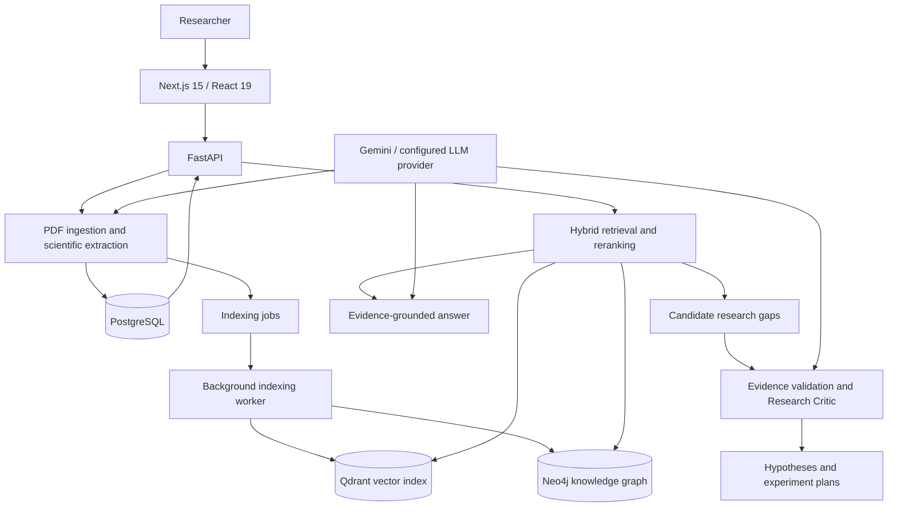

# DiscoveryAI

**Evidence-grounded scientific research discovery**

DiscoveryAI is a research prototype for exploring scientific literature beyond keyword search. It combines scientific document extraction, hybrid retrieval, a knowledge graph, evidence-linked answers, candidate research-gap analysis, and hypothesis/experiment planning within a defined indexed corpus.

[](https://github.com/shaikhkhushi-01/DiscoveryAI/actions/workflows/ci.yml)
[](https://discovery-ai-swart.vercel.app/)
[](https://discoveryai-6dmk.onrender.com/docs)
[](https://www.python.org/)
[](https://nextjs.org/)

| Resource | Link |
|---|---|
| Live application | [discovery-ai-swart.vercel.app](https://discovery-ai-swart.vercel.app/) |
| Interactive API docs | [discoveryai-6dmk.onrender.com/docs](https://discoveryai-6dmk.onrender.com/docs) |
| Source repository | [github.com/shaikhkhushi-01/DiscoveryAI](https://github.com/shaikhkhushi-01/DiscoveryAI) |
| Evaluation status | [Scientific evaluation report](docs/submission/EVALUATION_STATUS.md) |

> **Research integrity.** DiscoveryAI is an advanced research prototype, not a scientifically validated product. The live Explore workflow has been manually verified for an evidence-grounded BERT question. Research-gap novelty, expert agreement, and baseline superiority have not yet been established through a completed independent evaluation.

## At a glance

DiscoveryAI is designed around one research question:

> Given a research question and a bounded scientific corpus, can a system identify candidate research opportunities, support or challenge them with traceable evidence, communicate uncertainty, and propose testable experiments?

The system is deliberately corpus-bounded. It can identify opportunities not represented in a named indexed corpus and search scope; it cannot prove that a topic has never been researched anywhere.

## Try the live demo

1. Open the [DiscoveryAI dashboard](https://discovery-ai-swart.vercel.app/).
2. Go to **Explore**.
3. Ask:

   `What is the masked language modeling objective used in BERT, and how does it help the model learn bidirectional representations?`

4. Inspect the generated answer and its numbered citations.
5. Select an evidence citation to jump to the corresponding retrieved passage.

**Verified demo journey (28 November 2026):** the deployed Explore flow returned an answer grounded in eight retrieved evidence passages from the BERT paper. Citation links navigated to the corresponding passages in the page. This is a functional smoke test of one question over the current indexed corpus—not a benchmark score, broad-coverage claim, or validation of research-gap novelty.

The public corpus is intentionally small and may change as papers are added or re-indexed.

## Core capabilities

| Capability | What it does |
|---|---|
| Scientific document ingestion | Accepts PDFs, extracts text and metadata, and prepares papers for indexing. |
| Structured scientific extraction | Identifies scientific concepts and structured information from paper content. |
| Hybrid retrieval | Combines semantic/vector, lexical, and graph-based retrieval with evidence fusion and reranking. |
| Evidence-grounded answers | Generates answers from retrieved passages and links claims to source evidence. |
| Scientific knowledge graph | Represents papers and extracted scientific entities/relationships. |
| Research-gap analysis | Produces candidate opportunities and checks them against evidence within the indexed corpus. |
| Research Critic | Challenges candidate claims and distinguishes supported, contradicted, and uncertain cases. |
| Research planning | Generates hypotheses and proposed experiment plans with datasets, baselines, and metrics. |
| Evaluation framework | Provides benchmark schemas, baseline/ablation runners, and expert-agreement analysis tooling. |

## Architecture



### Request lifecycle

1. A researcher submits a paper through the authenticated document API.
2. The ingestion pipeline validates and parses the PDF, extracts metadata and scientific content, and persists document records.
3. An indexing job generates embeddings and writes chunk vectors to Qdrant; extracted entities and relationships are written to Neo4j.
4. A research query retrieves candidate passages through semantic, lexical, and graph paths.
5. Evidence fusion and reranking select source passages for answer generation or downstream research analysis.
6. Candidate research gaps are treated as hypotheses to investigate—not as proof of global novelty.
7. Hypotheses and experiment plans are proposals until researchers execute and evaluate them.

## Technology

| Layer | Stack |
|---|---|
| Frontend | Next.js 15, React 19, TypeScript |
| Backend | Python 3.12, FastAPI, Pydantic |
| Relational database | PostgreSQL, SQLAlchemy, Alembic |
| Vector database | Qdrant |
| Knowledge graph | Neo4j |
| Background/runtime support | Redis and indexing worker |
| LLM / embeddings | Gemini provider and configurable provider abstractions |
| PDF processing | PyMuPDF |
| Quality checks | pytest, TypeScript type-check, Next.js production build, GitHub Actions |
| Deployment | Vercel frontend, Render API; Docker Compose for local development |

## Repository structure

```text
backend/
  app/api/           FastAPI routes and request schemas
  app/services/      ingestion, extraction, retrieval, graph, reasoning
  app/models/        persistence models
  app/tests/         backend unit and regression tests
  alembic/           database migrations
frontend/            Next.js application
data/evaluation/     benchmark schemas and starter templates
research/            research protocols, rubrics, and release gates
scripts/benchmarks/  QASPER preparation and evaluation utilities
scripts/evaluation/  benchmark, baseline, ablation, and agreement tools
docs/submission/     project report, architecture, evaluation, demo
.github/workflows/   CI and scheduled research/indexing workflows
docker-compose.yml   local multi-service development stack
```

## Run locally

### Prerequisites

- Python 3.12
- Node.js 20+ and npm
- Docker Engine with Docker Compose
- Provider credentials for live LLM/embedding operations

### 1. Configure environment

From the repository root, copy `.env.example` to `.env` and fill in the required local values. The frontend uses `frontend/.env.local.example` as its template:

**macOS / Linux**
```bash
cp .env.example .env
cp frontend/.env.local.example frontend/.env.local
```

**Windows PowerShell**
```powershell
Copy-Item .env.example .env
Copy-Item frontend/.env.local.example frontend/.env.local
```

Set `NEXT_PUBLIC_API_URL=http://localhost:8000` in `frontend/.env.local` for local API access. Never commit real API keys, database credentials, JWT secrets, or private research documents.

### 2. Start infrastructure

```bash
docker compose up -d postgres neo4j qdrant redis
```

### 3. Start the backend

```bash
cd backend
python -m venv .venv
```

Activate the environment:

**macOS / Linux**
```bash
source .venv/bin/activate
```

**Windows PowerShell**
```powershell
.venv\\Scripts\\Activate.ps1
```

Install dependencies, apply migrations, and start the API:

```bash
pip install -r requirements.txt
alembic upgrade head
uvicorn app.main:app --reload
```

The API is available at [localhost:8000](http://localhost:8000); interactive documentation is at [localhost:8000/docs](http://localhost:8000/docs).

### 4. Start the frontend

In a second terminal:

```bash
cd frontend
npm install
npm run dev
```

The dashboard is available at [localhost:3000](http://localhost:3000).

### 5. Or use Docker Compose

From the repository root:

```bash
docker compose up --build
```

Review the development-only default credentials in the Compose configuration before exposing any service beyond localhost.

## API entry points

| Endpoint | Purpose | Access |
|---|---|---|
| `GET /health` | API process health | Public |
| `GET /api/v1/health` | API health route | Public |
| `GET /api/v1/public/overview` | Public dashboard overview | Public |
| `GET /api/v1/public/gaps` | Public candidate-gap view | Public |
| `GET /api/v1/public/trends` | Public trends view | Public |
| `POST /api/v1/public/graph-rag/retrieve` | Evidence retrieval | Public |
| `POST /api/v1/public/graph-rag/ask` | Evidence-grounded question answering | Public |
| `POST /api/v1/documents/upload` | PDF ingestion | Authenticated |
| `POST /api/v1/documents/{id}/index` | Document indexing | Authenticated |
| `/api/v1/gaps` | Candidate gaps and critic workflows | Authenticated |
| `/api/v1/intelligence` | Hypotheses, comparison, and literature review | Authenticated |
| `/api/v1/agents` | Discovery workflows | Authenticated |

The deployed [OpenAPI documentation](https://discoveryai-6dmk.onrender.com/docs) is the source of truth for current request and response schemas.

## Engineering quality

The GitHub Actions pipeline checks:

- Python source compilation.
- Backend unit and regression tests.
- Frontend TypeScript type-check and production build.
- Repository foundation and release-readiness checks.
- Docker Compose configuration validity.

Run the core checks locally:

**Backend** (from `backend/`):
```bash
pip install -r requirements.txt pytest pytest-asyncio
PYTHONPATH=. pytest app/tests tests ../tests -q
python -m compileall app
```

**Frontend** (from `frontend/`):
```bash
npm install
npm run typecheck
npm run build
```

**Repository release check** (from the root):
```bash
python scripts/evaluation/release_check.py
```

## Scientific evaluation and limitations

DiscoveryAI includes tooling for a future controlled evaluation, but the existence of an evaluator does not mean the system has passed the evaluation.

Implemented evaluation tooling includes:
- A versioned DiscoveryGapBench schema and annotation rubric.
- A benchmark validator and adjudicated-gold evaluation runner.
- Five-system baseline comparison and component ablation runners.
- Dual-reviewer agreement analysis and reproducibility metadata.

Still pending:
- A frozen, clearly scoped corpus snapshot for the benchmark.
- Independent expert annotations and adjudication.
- Complete prediction artifacts for all baselines and ablations.
- Measured performance, expert agreement, and held-out error analysis.

Do not interpret starter templates or weak labels as expert gold data. Do not report benchmark performance, baseline superiority, or global-novelty claims until the evaluation protocol has been completed.

See [Evaluation Status](docs/submission/EVALUATION_STATUS.md), [Project Report](docs/submission/PROJECT_REPORT.md), and [Architecture](docs/submission/ARCHITECTURE.md) for detail.

## Deployment

- Frontend: [discovery-ai-swart.vercel.app](https://discovery-ai-swart.vercel.app/)
- Backend: [discoveryai-6dmk.onrender.com](https://discoveryai-6dmk.onrender.com/)
- API docs: [Swagger UI](https://discoveryai-6dmk.onrender.com/docs)

A successful health response confirms that the API process responds; it does not establish that PostgreSQL, Qdrant, Neo4j, Redis, the LLM provider, or every protected workflow is healthy. Validate dependencies and user journeys independently.

## Research integrity

- Scope novelty statements to a named corpus snapshot and search protocol.
- Preserve provenance from generated claims to papers, documents, and chunks.
- Surface contradictory evidence and uncertainty.
- Keep raw annotations, adjudication, and held-out test labels separate.
- Record model/provider, prompt, embedding and retrieval configuration, code revision, corpus version, split, and random seed for each evaluation run.
- Report negative results and limitations; do not tune on the held-out test set.

## Project documents

- [Project report draft](docs/submission/PROJECT_REPORT.md)
- [Architecture and data flow](docs/submission/ARCHITECTURE.md)
- [Scientific evaluation status](docs/submission/EVALUATION_STATUS.md)
- [Presentation outline](docs/submission/PRESENTATION_OUTLINE.md)
- [Demo script](docs/submission/DEMO_SCRIPT.md)

These materials describe the current implementation and planned evaluation. They are not a substitute for completed empirical validation.

## License

No license has been declared in this repository. All rights are reserved by default; contact the repository owner before reusing or redistributing the code.
