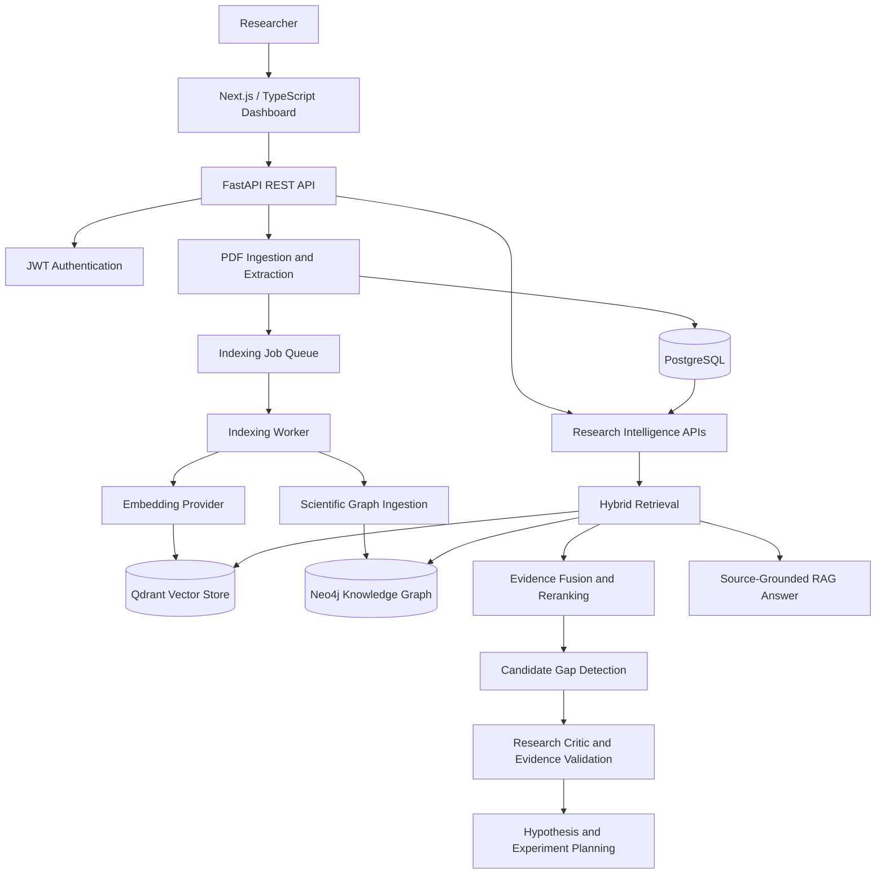

# DiscoveryAI Architecture

## System context

## Request and indexing flow

1. Researcher authenticates and receives a bearer token.
2. PDF upload validates type/content and computes a checksum.
3. The parser extracts text, sections, references, tables, figures, and metadata.
4. Structured extraction identifies scientific fields.
5. PostgreSQL stores the paper, document, extracted text, and indexing metadata.
6. The indexing API creates a durable database job.
7. The worker generates embeddings and upserts chunk vectors into Qdrant.
8. The worker maps extracted entities and relationships into Neo4j.
9. Job status records vector and graph outcomes separately.

## Retrieval and reasoning flow

1. A natural-language research query is embedded.
2. Vector retrieval returns semantically similar chunks.
3. Keyword retrieval contributes lexical matches.
4. Graph search and graph expansion contribute structural context.
5. Fusion and reranking combine candidate evidence.
6. RAG generates a response grounded in the retrieved evidence.
7. Gap detection derives candidates from the indexed graph and validates them against retrieval evidence.
8. Research Critic classifies candidates as bounded corpus-level opportunities, already-addressed claims, or cases requiring review.
9. Hypothesis generation and experiment planning produce proposals, not observed experimental results.

## Data responsibilities

| Store | Responsibility | Must not be confused with |
|---|---|---|
| PostgreSQL | Users, papers, documents, metadata, indexing jobs | Vector or graph index |
| Qdrant | Chunk embeddings and semantic search payloads | Source-of-truth relational records |
| Neo4j | Scientific entities and relationships | Complete full-text document archive |
| Object/local file storage | Uploaded PDF bytes | Durable DB metadata |

## Operational boundaries

- The API health route proves only that the process responds.
- PostgreSQL connectivity does not prove Qdrant or Neo4j availability.
- A successful indexing job must report vector and graph status separately.
- Dashboard API connectivity must not be represented as proof of populated research data.
- Research gap claims are limited to the corpus snapshot and search scope.
- Hypotheses and experiment plans are proposals until independently executed.
